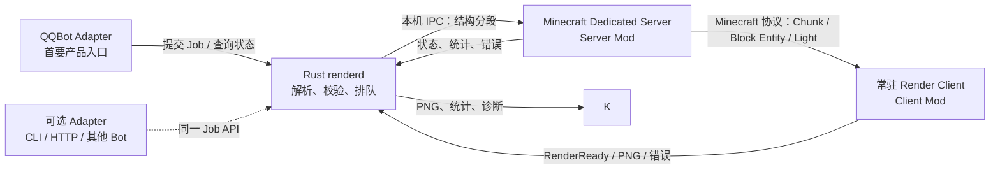
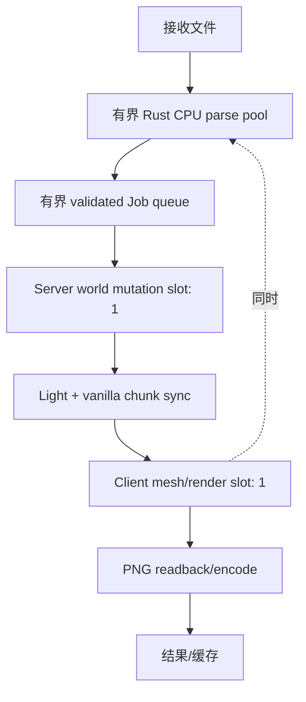

# Minecraft Litematic Render Service：工程设计文档

**状态：** 提案（可进入原型阶段）  
**编写日期：** 2026-10-24  
**目标：** 将 Litematic 的解析、世界状态处理和图片渲染拆成可控、可复用、可并发调度的服务。

> **已被新版方案取代。** 由于产品接受方块模型和光照近似，当前 QQBot 项目不再需要 Minecraft Client/Server 作为渲染依赖。请以 [QQBot Rust 无头渲染工程设计](qqbot-litematic-rust-renderer-engineering-design.md) 为准；本文保留原高保真 MC Client/Server 拓扑，作为历史方案记录。

## 1. 摘要

本项目把 Minecraft 的高保真结构预览做成一个常驻渲染服务。Rust 负责读取和校验 `.litematic`，Minecraft Server Mod 负责把已解析结构放入隔离的临时世界、使用 Minecraft 的方块注册表和光照系统完成准备，Render Client Mod 接管 Client 的任务循环并调用 Minecraft 自己的世界渲染路径。Client 复用同一个进程处理连续任务；GPU 工作按任务提交，读回图片后回收任务级资源。



**核心设计决定：**

1. Rust 解析 Litematic 容器和方块数据；Server 依据自身注册表确认方块状态，不接收 Rust 生成的版本相关数字方块 ID。
2. 方块和光照从 Server 到 Client 优先走 Minecraft 自带的 Chunk/Light 网络同步路径。自定义 Mod 消息只承载任务控制，不再自造一份 Client 世界同步协议。
3. 第一版使用一个预先配置的隔离渲染世界和一个 Client。任务可以并行解析和排队，但同一个 Server 世界修改阶段串行，同一个 Client 的渲染提交默认一次一个任务。
4. Client 保留 Minecraft 资源、模型烘焙、Chunk mesh、方块实体渲染和目标图形后端；Mod 控制任务时机、相机、离屏目标、读回和清理。
5. Vulkan 是渲染后端，不是自动降低 GPU 使用率的开关。资源节省主要来自不跑普通游戏循环、不持续刷新、不启动多个 Client、控制输出分辨率和每任务的 GPU 工作量。

## 2. 背景与当前版本事实

截至本文日期，Java Edition 26.3 是已发布版本；官方快照列表已有 26.4 快照。26.1 起游戏 JAR 不再混淆，便于阅读字节码和编写 Mod，但 Mojang 没有因此发布一个可自由复制、分发的官方源码仓库。日常阅读仍是对官方 JAR 反编译得到的近似 Java 源码。Fabric 在 26.1 迁移说明中介绍了 `mcsrc.dev`，它会下载 Mojang JAR 并在浏览器中反编译，可用于快速搜索；正式开发仍以本地 Fabric Loom 工作区和目标版本实际 JAR 为准。[Mojang：移除 Java Edition 混淆](https://www.minecraft.net/en-us/article/removing-obfuscation-in-java-edition) · [Fabric：Minecraft 26.1](https://www.fabricmc.net/2026/03/14/261.html)

Vulkan 在 26.2 加入时被标记为实验后端，用户可在图形 API 设置中选择；26.4 Snapshot 1 将 Vulkan 设为默认行为。对工程而言，这意味着必须在启动时确认实际运行后端，不能假设“版本够新就一定在用 Vulkan”。建议以已发布的 26.3 作为第一条稳定兼容线，并把 26.4 快照作为单独的升级试验线。26.3 的 Fabric 发布说明列出 Loom 1.17、Gradle 9.6.0 和 Loader 0.19.5；实际开始时应再次核对该版本的 Fabric 模板和依赖版本。[Minecraft 26.2 Vulkan 说明](https://feedback.minecraft.net/hc/en-us/articles/46690753273997-Minecraft-Java-Edition-26-2) · [Minecraft 26.4 Snapshot 1](https://www.minecraft.net/en-us/article/minecraft-26-4-snapshot-1) · [Fabric：Minecraft 26.3](https://fabricmc.net/2026/09/15/263.html)

### 2.1 版本矩阵

| 范围 | 原型基线 | 设计要求 |
|---|---|---|
| Minecraft | Java Edition 26.3 | 一次只支持一个精确游戏版本及其补丁版本；版本升级作为单独适配工作。 |
| Java | JDK 25 | 编译和运行都锁定 JDK major；JVM 参数由 benchmark 决定。 |
| Fabric | 与 26.3 对应的 Loader/API | Fabric 26.3 文章给出的开发基线为 Loom 1.17、Gradle 9.6.0、Loader 0.19.5。 |
| 图形后端 | Vulkan 优先，运行时检测 | 26.2 起有 Vulkan 支持；启动时确认 Vulkan device、实际 backend、所需能力和 fallback。 |
| 试验版本 | 26.4 snapshots | 不进入默认生产包；每个快照单独记录渲染差异和 Mod 注入点变化。 |

版本号和 Fabric 依赖应保存在一个兼容性清单中。Server 与 Client 的 Minecraft 协议版本、Mod 版本、注册表/内容 Mod 集合和有效资源包集合必须匹配。任何一项不匹配都要在 Job 进入世界注入前失败，不能继续生成可能错误的图片。

## 3. 目标、边界和验收结果

### 3.1 目标

- 面向 QQBot 提供 `.litematic` 渲染能力：由 QQBot Adapter 接收请求并转交 Job，完成后把 PNG、结构统计和诊断信息回传；保留同一 Job API 给 CLI、HTTP 服务或其他 Bot Adapter 扩展。
- 用 Rust 在 Minecraft 进程外完成文件解析、校验、压缩数据准备和任务排队。
- 使用 Server 注册表解析结构中的 `namespace:block[property=value]`，由 Server 管理光照与服务器侧统计。
- 让一个常驻 Render Client 连续处理多个任务，避免逐任务启动 Minecraft。
- 让 Client 使用原生模型、材质、资源包、Chunk 构建和渲染机制；Mod 可接管渲染时序，并在经过验证后使用 Vulkan 资源完成离屏输出。
- 支持受限的任务并发：Rust 解析并发，Server/Client 阶段有界排队，内存和 GPU 临时资源有明确上限。
- 保留来源版本、资源包摘要、Mod 集合摘要、输入哈希和渲染参数，确保任务可复现、可诊断。

### 3.2 第一阶段不做

- 不重新实现 Minecraft 的模型系统、光照显示或完整光栅化器。
- 不分发 Minecraft Client/Server JAR、官方纹理、音乐或其他官方内容。部署者自行通过官方渠道取得运行时和内容；Mod 只分发原创代码。许可边界以当前 EULA 和使用指南为准。[Minecraft EULA](https://www.minecraft.net/en-us/eula)
- 不在玩家的真实世界里注入结构，不操作玩家正在玩的世界。
- 不为每个 Job 动态创建 Minecraft Dimension。第一版预配置一个私有渲染世界，避免动态注册维度和生命周期带来的额外状态。
- 不承诺所有资源包、所有 Modded Block Entity、动画、实体、粒子、天气、后处理或 shader 都能一比一呈现。
- 不承诺 Vulkan 一定比 OpenGL 更快，也不把 Vulkan 当成减少 GPU 工作量的手段。
- 不在第一版允许多个 Job 同时向同一个 GPU 队列提交渲染；先实现流水线并发和单渲染槽，再根据实测增加并行 worker。

### 3.3 MVP 验收条件

1. Rust 能解析受支持的 Litematic 版本，正确处理多个 Region、负坐标、调色板、packed block indices 和 Block Entity NBT；坏输入会在边界处被拒绝，进程保持存活。
2. Server 能把一个 Job 放入专用渲染世界，确认状态解析无误，等待光照队列完成，并将需要的 Chunk/Light 数据同步给已连接的 Render Client。
3. Client 能确认目标 Chunk、Light、资源加载和 Chunk mesh 均已就绪，使用确定的相机设置渲染一张图片，并在 GPU 完成后读回 PNG。
4. 同一个 Client 连续处理至少一批固定回归结构；后一个 Job 不含前一个 Job 的方块、Block Entity、光照或 mesh 缓存残留。
5. 同一输入与配置重复提交时，服务行为幂等；重复 JobId 搭配不同输入哈希会明确拒绝。
6. 渲染失败、超时、取消和 Client/Server 重启均产生可识别状态；不会把未完成的 Job 报告为成功。
7. 日志能用 `jobId` 关联 Rust、Server、Client 三端；记录解析、注入、光照、同步、mesh、GPU submit、fence、readback 和清理各阶段耗时。

具体性能目标（平均/尾延迟、最大结构大小、内存上限、每小时任务量）需要用代表性 Litematic 基准测量后制定。本文不预先编造吞吐承诺。

## 4. 能力拆分与依赖

| 模块 ID | 责任 | 实现 | 依赖 |
|---|---|---|---|
| `qqbot-adapter` | QQBot 命令/事件适配、请求身份与权限映射、文件接收/获取、结果回传 | 独立入口模块；平台 SDK 与部署方式待选型 | `renderd` Job API |
| `renderd` | Job API、Job 生命周期、IPC 端点、队列、结果缓存、指标 | Rust | 无；服务协议先冻结 |
| `litematic-ingest` | 压缩检测、NBT 解码、Litematic 语义、边界和资源限制 | Rust | `renderd` Job 模型 |
| `render-server-mod` | 注册表校验、隔离世界写入、Chunk ticket、光照完成屏障、统计 | Java/Fabric | `renderd` IPC；目标 MC 版本 |
| `render-client-mod` | 连接/接收状态、相机、渲染任务控制、GPU 捕获、截图和清理 | Java/Fabric | Server Mod 的 Job 控制消息；目标 MC 版本 |
| `version-adapter` | 各 Minecraft/Fabric 版本的注入点和图形 API 差异 | Java/Fabric | Server/Client Mod |
| `render-fixtures` | NBT fixture、黄金图、资源包和基准场景 | 数据/脚本 | 全部模块 |

依赖方向：

```text
litematic-ingest → Rust Job DTO → render-server-mod → Minecraft Chunk/Light 协议
                                                    ↓
                                              render-client-mod
                                                    ↓
                                               PNG / 结果
```

Minecraft 版本专用代码限制在 `version-adapter` 和 Client/Server 的边界层内。Rust 协议不包含 Java 类名、Minecraft 私有数值 ID 或 GPU 句柄。

## 5. 运行时拓扑与进程职责

### 5.1 生产拓扑

- **QQBot Adapter（首要产品入口）：** 将 QQBot 命令/事件、用户与群上下文、上传文件映射为 `renderd` Job API 请求；把任务状态、图片与诊断结果映射回 QQBot 消息。平台 SDK、鉴权和消息发送细节留在 Adapter，不进入 NBT/渲染核心。
- **可选 Adapter：** CLI、HTTP 或其他 Bot 入口复用相同 Job API；属于扩展点，不改变 QQBot 首要入口的产品定位。
- **Rust `renderd` Job API：** 所有入口共同使用的稳定任务边界，负责请求校验、生命周期、限流、队列和结果读取。
- **Rust `renderd`：** 单一调度控制面；读取 Adapter 提交的输入、校验、生成规范 DTO、维护有限队列、连接 Server Mod、收集 Server 统计和 Client 图片。
- **Minecraft Dedicated Server + Server Mod：** 启动固定的隔离渲染世界；不提供玩家玩法；接收 section 数据，解析 Registry 状态，放置方块，等待光照，控制 Chunk 加载和同步。
- **Minecraft Render Client + Client Mod：** 常驻并连接专用 Server；保留 Minecraft 原生资源和世界渲染路径；不等待人操作；按任务渲染一帧/一个结果。

Rust、Server 和 Client 可以部署在同一主机；如果使用同机，控制面使用 Windows Named Pipe 或 Unix Domain Socket，并设置本机访问权限。若必须使用 TCP，应绑定回环地址，带版本握手和访问控制；不可将未经认证的 Job 注入端口暴露给公网。

### 5.2 Server 到 Client 的世界同步

建议使用标准 Minecraft Server→Client 的世界/Chunk/Light 同步数据承载世界内容；使用 Mod 自定义 payload 传递 `jobId`、render bounds、配置、准备状态和 Client acknowledgement。这样 Client 的 Chunk 接收、光照缓存和 Chunk mesh 由 Minecraft 自己的同步/渲染流程驱动，减少两套世界状态协议发生偏差的机会。

这项决定有一个前置验证：Render Client 必须能在部署使用的账户/运行模式下合法、自动化地连接本机专用 Server。不得通过修改认证绕过流程来解决。若自动化连接成为阻塞点，单独评估“Client 进程内 Integrated Server”的原型拓扑；不要同时维护两套数据同步实现。

### 5.3 线程职责原则

| 执行单元 | 可以做什么 | 不应做什么 |
|---|---|---|
| QQBot Adapter event loop | 接收平台事件、执行交互/权限映射、交接文件和回传结果 | 直接操作 Minecraft 世界或渲染资源；阻塞等待整项渲染完成 |
| Rust Tokio/I/O runtime | Job API/IPC、文件 I/O、Job 状态、限流和流式收发 | 在 async worker 上执行大型 NBT 解码或 CPU 渲染 |
| Rust CPU pool | NBT 解码、palette/section 解包、坐标转换、哈希、压缩 | 访问 Minecraft Java 对象 |
| Server 网络线程/IPC 线程 | 收帧、长度/校验检查、排队 | 直接修改 `ServerLevel`/Chunk/Block Entity |
| Server 主线程 | 通过受控 Job 步骤修改世界、申请 Chunk ticket、提交状态变更 | 阻塞等待光照队列或 GPU |
| Server 光照/Chunk worker | 执行 Minecraft 自身排定的异步工作 | 与 Rust 线程直接共享可变 World 对象 |
| Client 网络线程 | 接收标准包和 Mod 控制消息、投递到对应线程 | 直接创建 Vulkan 资源或改渲染线程状态 |
| Client render thread | 修改相机/RenderTarget、调用原生渲染、提交 GPU work、安排 readback | 阻塞做大型 NBT 解析或网络读 |
| Vulkan queue/GPU | 执行已提交 command buffer | 被非拥有线程随意等待/销毁资源 |

**不要冻结整个 Server。** Server 的主循环、网络收包和光照/Chunk 队列仍需运行。可以冻结或关闭渲染世界中不需要的 gameplay tick、随机更新和实体逻辑，但不能把仍负责处理任务和光照的调度路径一起停掉。

## 6. Rust Litematic Loader 设计

### 6.1 输入处理顺序

1. 检查原始文件长度、文件类型和压缩格式；对压缩数据设定解压后大小上限和展开比上限。
2. 解码 NBT 时实施最大深度、标签数、字符串长度、数组长度和总内存上限。
3. 验证 Litematic 顶层版本字段、Regions、尺寸、位置、palette、packed block state 数组和 Block Entity 集合。
4. 对每个 Region 转换其局部坐标到统一结构坐标；保留源 Region 名和源坐标作为诊断信息。
5. 校验 palette index 不越界，尺寸乘法无整数溢出，解码后 block 数不超过配置上限。
6. 生成按 Section 分组的规范 DTO；对空 Section 可编码为空/全空气，不必传输逐方块数据。
7. 生成 `inputHash`、section hash 和总 `sceneHash`，供重试、缓存和日志关联。

### 6.2 坐标与 palette

- Rust 以有符号坐标处理 Region 原点和结构最小边界；禁止假设 Region 原点总是非负。
- 每个 palette 项保存 namespaced block id 与 properties 的键值对。服务端根据自身版本和 Registry 解析，例如 `minecraft:oak_stairs` 与 `facing=east,half=bottom,shape=straight`。
- 禁止把某版本内部的数值 BlockState/Block ID 当作协议数据；这些数字不是跨版本契约。
- BlockStates 的 bit packing、跨 Long 边界规则和旧版本差异必须从真实 Litematic 文件建立 fixtures 验证；解析器不得只按一个猜测的 unpack 算法实现。
- Block Entity 数据保持类型化 NBT 语义。Rust 负责读取外围 NBT 和定位 payload；Server 可对具体 Block Entity payload 做 Minecraft 版本对应的 NBT 解码/Codec 处理，因为该对象最终由 Server Registry 实例化。
- 结构旋转/镜像先不在服务端自动变换，首版只传原始朝向和 bounds；后续相机/结构变换另立协议字段并写成明确坐标变换规范。

### 6.3 输入防护

Litematic 是外部输入。至少限制：原始文件大小、解压后大小、NBT 深度、Region 数、最大 XYZ、总方块数、palette 长度、Block Entity 数量和单个 payload 长度。所有乘法、偏移、字节长度检查使用 checked arithmetic。对不支持的版本、未知标签、超范围结构和错误 palette index 返回结构化错误，不执行部分注入。

Rust 阶段错误例：

```text
INVALID_COMPRESSION
NBT_LIMIT_EXCEEDED
UNSUPPORTED_LITEMATIC_VERSION
INVALID_REGION_BOUNDS
INVALID_PALETTE_INDEX
BLOCK_STATE_DATA_LENGTH_MISMATCH
BLOCK_ENTITY_LIMIT_EXCEEDED
```

## 7. Rust ↔ Server IPC 契约

### 7.1 传输与帧格式

首版采用本机 Named Pipe/Unix Domain Socket；使用 Protobuf 做控制消息和小元数据，Section 的 packed indices 作为 `bytes` 字段流式传输。若依赖或 Java/Rust 代码生成工具不适合 Protobuf，替代方案也必须是有 schema/version 的稳定编码，不使用 Rust `bincode` 的隐式 Rust 类型布局直接作为跨语言协议。

每个 IPC frame 至少有：

```text
magic              固定协议标识
protocol_major     不兼容协议版本
protocol_minor     向后兼容扩展版本
message_type       消息类型
job_id             128-bit 稳定任务 ID
sequence           单 Job 消息序号
payload_length     明确字节长度，有全局上限
payload_checksum   CRC32C 或等价校验
payload            Protobuf 控制体/Section bytes
```

长度必须在分配 buffer 前验证。协议读写必须支持 partial read、partial write、连接中断、重复 frame 和超时；不得假设一次 `read` 会拿到完整消息。

### 7.2 核心消息

| 消息 | 方向 | 语义 |
|---|---|---|
| `HELLO` | 双向 | 协商协议版本、Minecraft 版本、Mod build、能力、资源包摘要、注册表/内容 Mod 摘要。 |
| `SUBMIT_BEGIN` | Rust→Server | 创建 Job；包含 JobId、输入摘要、bounds、palette、资源配额、渲染 profile。 |
| `SUBMIT_SECTION` | Rust→Server | 一个 section 的 packed state indices、位置、可选压缩和 section hash。可分块流式传输。 |
| `SUBMIT_BLOCK_ENTITY` | Rust→Server | Block Entity 坐标、类型 ID 和 NBT payload。 |
| `SUBMIT_COMMIT` | Rust→Server | 表示数据发送完毕；Server 验证 section 数与总 hash。 |
| `JOB_ACCEPTED` | Server→Rust | 接受/拒绝；返回服务端解析出的统计和诊断。 |
| `JOB_STAGE` | Server→Rust | 状态变化，如 `APPLYING`、`LIGHTING`、`READY_FOR_CLIENT`。 |
| `JOB_RENDER_READY` | Server→Client | 控制数据：jobId、目标 bounds、相机 profile、场景 revision。世界数据仍通过标准 Minecraft Chunk/Light 同步。 |
| `CLIENT_SCENE_READY` | Client→Server | Client 已收到要求的 Chunk/Light/Block Entity 数据；开始等待 mesh rebuild 屏障。 |
| `CLIENT_MESH_READY` | Client→Server/Rust | Client 对此 revision 的 required chunk mesh 已完成。 |
| `RENDER_RESULT` | Client→Rust | PNG bytes、dimensions、format、hash、实际 backend 和 render metadata。 |
| `CANCEL` | Rust→Server/Client | 请求取消；按线程所有权执行安全清理。 |
| `JOB_FAILED` | 任一→Rust/对端 | 稳定错误码、阶段、可重试标记和安全诊断文字。 |

协议要求：JobId 是意图级 ID，在重试时保持不变；同一个 JobId 配上不同 `inputHash` 必须拒绝。Server 对重复提交返回已记录状态/结果，不能重复叠放结构。

### 7.3 结构化 DTO（概念）

```text
JobManifest {
  jobId: UUID
  inputHash: Hash256
  expectedMinecraftVersion: string
  bounds: { minX, minY, minZ, sizeX, sizeY, sizeZ }
  palette: [{ blockId, properties: map<string,string> }]
  sectionCount: uint32
  blockEntityCount: uint32
  renderProfile: { cameraPreset, width, height, background, transparencyMode }
}

SectionPayload {
  sectionX, sectionY, sectionZ: int32
  paletteBitWidth: uint8
  packedIndices: bytes
  uncompressedByteLength: uint32
  sectionHash: Hash256
}
```

Section 数据可独立压缩，建议以 Section 为流控单位。压缩算法和级别由 benchmark 决定；协议声明压缩 codec，不允许接收方凭猜测解压。

## 8. Server Mod：权威世界、统计和光照屏障

### 8.1 渲染世界隔离

Server 使用独立的专用 Render Server 进程和固定渲染维度/世界配置。该世界不包含玩家真实存档，不自动保留 Job 结构，不运行普通生存玩法。第一版同一时刻只写入一个 Job；完成后清理该世界覆盖的 Chunk/Section，再接收下一个。不要为每个任务临时注册新 Dimension，也不要将多个 Job 放在同一坐标范围覆盖彼此。

可以允许 Rust 同时解析多个文件并把规范数据排队，但 Server 的世界变更必须在 Server 主线程按 Job 顺序应用。这样隔离不同 Job 的 Block Entity、Chunk cache、Light Engine 队列和 World revision。扩大 Server 并行吞吐时，增加独立 Server worker 进程，而不是让多个线程同时改一个 `ServerLevel`。

### 8.2 注入步骤

1. 在提交前完整检查 bounds、palette 所有项、方块状态属性和所有 Block Entity payload；如果任何状态无法解析，整体拒绝 Job。
2. 申请需要的 Chunk ticket 并确认目标 Chunk 已创建/加载。
3. 在 Server 主线程按 Chunk Section 分批写入方块，使用目标版本中安全的区块/世界 API。
4. 尽量抑制不需要的邻居通知、声音、掉落、世界事件和保存行为，但不能绕过 Section/Heightmap/Light Engine 的必要不变量。内部直接写 Section 只有在版本源码和集成测试证明所有缓存/更新均被正确处理后才能考虑。
5. 按已验证的 Server API 提交光照更新；Server 主线程不能阻塞等待光照线程。通过任务计数/回调/版本适配层屏障确认目标范围所需 light work 全部完成。
6. 计算 authoritative stats：解析成功的方块数、未知/替换状态数、Block Entity 数、bounds、占用体积等。与 Rust 的统计对照用于发现数据问题。
7. 固化 `sceneRevision`/`sceneHash`，通知 Client 开始同步。此后 READY 之前不允许修改此 Job 的世界数据。

### 8.3 Light Engine 与 Client Lighting

Server 负责 Minecraft 世界中的天空光/方块光传播，Client 负责用 Minecraft 的客户端光照显示流程把每个 block light/sky light 值映射到画面，并结合当前资源包/环境设置完成渲染。Server 光照结果本身不等于最终像素颜色。

Server READY 意味着 Server 的 light work 已完成并可同步；Client 仍必须等到 Chunk/Light 包到达、客户端世界 revision 更新、相关 Chunk mesh rebuild 完成。两个屏障不能混为一个 ready flag。光照算法、队列实现和 Chunk 更新 API 均按具体版本源码确认；不要通过 `sleep(1000)` 或等待固定 tick 数来猜完成。

### 8.4 关闭玩法更新

渲染世界尽可能关闭：随机 Tick、天气、实体生成/AI、红石持续活动、方块掉落、自动保存和不相关 chunk loading。保持 Server 主循环、网络任务、Chunk tickets、光照处理和自定义 Job 队列运行。若某类更新是 Block Entity 正确初始化或渲染所必需，给它单独的受控初始化步骤，不开启整套世界 tick。

## 9. Render Client Mod：一次启动，连续渲染

### 9.1 启动配置与保留功能

Render Client 在启动配置中选择 `render-service` profile。Mod 可阻止输入、音频设备、GUI/HUD、普通玩家交互、粒子生成、实体逻辑、天气更新和常规连续帧刷新等非必要路径；每项在独立 feature gate 中实现并可回退。

必须保留并按启动状态机加载：

- Minecraft/Mod 注册表、资源包管理、模型和纹理 bake、字体/必要渲染资源；
- Client network、Chunk data、Light data、Block Entity 同步；
- `ClientLevel` 生命周期、Chunk cache 和 Chunk rebuild dispatcher；
- 原生 GameRenderer/LevelRenderer 中实际需要的世界绘制、方块实体渲染、光照与材质流程；
- RenderSystem/Blaze3D 以及 Minecraft 当前选择的图形后端；
- 操作系统事件泵（若窗口后端需要）、任务线程和日志。

不能在 `runTick`/主循环上简单全局 return。这样可能阻断资源 reload、网络 packet apply、chunk rebuild、render command drain 或窗口事件。目标是停止不必要的游戏功能执行，同时让必要的 Client 世界与渲染调度继续活着。

### 9.2 Client Job 状态机

```text
BOOTSTRAP
  → RESOURCES_READY
  → CONNECTED
  → WAITING_FOR_JOB
  → RECEIVING_WORLD
  → CLIENT_SCENE_READY
  → MESH_BUILDING
  → MESH_READY
  → GPU_SUBMITTED
  → GPU_COMPLETE
  → READBACK
  → CLEANUP
  → WAITING_FOR_JOB
```

每个任务带 `jobId + sceneRevision`。Client 的 readiness 和缓存都必须以两者为 key。旧 Job 的迟到 packet、旧 Chunk rebuild 完成事件或 fence signal 不能推进新任务状态。

### 9.3 单 Client 多任务

一个常驻 Client 完全可以重复处理任务。首版并发规则：

- 资源包、baked models、texture atlas、Pipeline/Shader 和 Vulkan device 常驻缓存。
- 一个 Client 同时只有一个活动 Render Job；新任务在队列内等待。
- Render job 结束后确认 GPU 工作完成，再清理任务级 World/Chunk/Block Entity/mesh/target/readback 状态。
- 清理完成后，Client 发 `CLIENT_SLOT_FREE`，队列才分配下一项。
- Rust 可以在当前 Client 渲染时解析后续 Litematic；Server 可以先做非世界对象的输入验证，但不能把下一 Job 注入当前 RenderWorld。

更高吞吐通过多个完整 worker 对扩展：每个 worker 有独立 Minecraft Server 渲染世界和 Render Client/GPU context。不要让多个 Client 进程默认共用一个 GPU device 的资源句柄，也不要用“多维度”暗示线程安全或独立吞吐。

### 9.4 相机与画面 profile

每个 Job 的 camera 参数需显式化：projection（orthographic/perspective）、位置、朝向、FOV/scale、target bounds、padding、输出分辨率、背景 RGBA、透明处理模式、时间/环境 profile 和画面方向。第一版固定预设，例如 `isometric_preview_v1`；变更渲染参数即更新 profile version，避免缓存命中错误。

固定天色、时间、天气、维度环境属性和视角；不依赖用户设置目录中任意的客户端画面选项。是否渲染天空/环境、是否透明背景均在任务配置明确指定。测试场景必须覆盖透明层与 cutout，不能只用实体石头方块验证。

## 10. Vulkan 与 GPU 捕获设计

### 10.1 接入策略

可在 Vulkan 层做直接读回/同步处理，但 Vulkan adapter 需要复用 Minecraft 已创建的 Instance/PhysicalDevice/LogicalDevice/Queue、资源生命周期和同步所有权。不要在同一 Client 中另建一个 Device/Queue 来绘制同一 Minecraft 纹理；不同 Device 不能直接共享普通纹理，额外 copy 和同步会抵消收益并增加错误面。

推荐分层：

```text
VanillaRenderBridge
    调用目标版本原生世界渲染路径并绘制到受控 RenderTarget
        ↓
CaptureBackend interface
    ├─ VulkanCaptureBackend（目标后端）
    └─ OpenGL/vanilla capture（调试 fallback，可选）
        ↓
PngEncoder（CPU 编码）
```

第一阶段先用 Minecraft 自带 framebuffer/screenshot 路径完成正确性原型；确认可复用设备、图像资源状态和 readback API 后，再实现 Vulkan 专用高效 readback。这样先把“可渲染”与“底层捕获优化”分开验证。

### 10.2 单 Job GPU 生命周期

```text
1. 分配/复用目标颜色图和深度图
2. Render thread 设置 camera 和 target
3. 原生 Minecraft 记录/提交正常世界渲染
4. 在正确 image layout / queue ownership 下复制到 host-visible staging buffer
5. 提交 fence/timeline semaphore
6. 返回 Client 任务循环继续处理非阻塞工作
7. GPU completion signal 到达后，在规定同步条件下 invalidate/non-coherent memory（如需要）并读回
8. 处理 row pitch、channel order、vertical orientation、sRGB/alpha
9. CPU 编 PNG 并回传 Rust
10. fence 完成后复用/释放 target、command buffer、staging buffer
```

禁止每帧 `vkDeviceWaitIdle` 或无条件 `vkQueueWaitIdle` 作为常规同步；这会把 CPU/GPU 管线强制串行。首版允许每任务等待独立 fence，以保证正确回收，再用 profiling 优化。初期 `max_in_flight_gpu_jobs = 1`。

### 10.3 GPU 使用控制

减少 GPU 消耗靠明确的工作上限：不持续绘制、不做 VSync 等待循环、不启动实体/粒子绘制、关闭不需要的后处理、固定分辨率与采样方式、只渲染任务需要的 Chunk，且每个 Job 只画一张结果图。Vulkan 可改变 API、同步和资源提交方式，但不会让原生 Chunk/Block Entity 绘制免费，也不保证比 OpenGL 更省电。

指标至少记录：实际图形 API、GPU 型号、输出像素数、渲染 pass 数、每 Job GPU time、submit→fence 延迟、readback 延迟、staging buffer 大小、当前/峰值 GPU 临时资源。若无法稳定确认实际后端，任务返回 `BACKEND_MISMATCH` 或按显式配置使用 fallback。

## 11. 并发、背压和资源预算



### 11.1 允许的并发

- 多个文件读取、解压、NBT 解析、section 解码、哈希可以并行，但受 CPU pool 和内存预算限制。
- IPC 传输可以与前一任务的 Client 渲染重叠；传输阶段遵循流控和最大接收 buffer。
- 同一个 Server 的世界注入第一版串行；光照按 Minecraft 自己的异步调度机制运行，但 Job 的 READY 屏障仍由 Job manager 管理。
- 同一个 Client 的 Vulkan 提交第一版串行；GPU 同一任务运行时 CPU 可解析后续任务。
- 多 Server/Client worker 可水平并发，worker 数根据实测 CPU、RAM、VRAM、GPU queue 和显存定。

### 11.2 背压

仅限制 Job 数量不够：一个大型结构的内存可远大于多个小结构。队列准入按估算资源权重计量，至少使用原始字节、解压后 NBT 字节、总 block 数、Section 数、Block Entity 字节和目标像素数。超过容量时返回 `QUEUE_FULL`/`RESOURCE_LIMIT`；QQBot Adapter 将其转换为用户可理解的稍后重试提示，其他 Adapter 可按相同错误类型实现各自交互。

Rust 的 parse pool 不超过 CPU 配置；Server 每个 worker 只允许一个 mutation Job；Client 每个 worker 只允许一个活动 render Job；总 VRAM 临时资源不能超过配置预算。取消任务必须释放其已计费预算。

## 12. 错误、重试和取消语义

### 12.1 Job 状态

```text
RECEIVED → PARSING → VALIDATED → QUEUED → SERVER_APPLYING → LIGHT_PENDING
          → SERVER_READY → CLIENT_SYNCING → CLIENT_MESH_PENDING → RENDERING
          → GPU_PENDING → READBACK → ENCODING → SUCCEEDED

任一非终态 → CANCEL_REQUESTED → THREAD_SAFE_CLEANUP → CANCELLED
任一阶段失败 → FAILED（含 stage、code、retryable）
```

状态持久化/恢复策略由 renderd 决定。最小可行实现可将 Job 记录写入本地 SQLite 或 append-only journal；若不做持久化，Server/Client 进程异常退出后 renderd 必须把处于执行中的 Job 标记为 `UNKNOWN_AFTER_WORKER_LOSS`，清理 worker 后从零重试，不能假定世界副作用未发生。

### 12.2 重试

- Rust 解析错误不可重试，除非输入文件改变。
- Server `BUSY` 可退避重试；状态/Registry 错误不可自动重试。
- Client/GPU device lost 后，当前 Job 失败并重启 Client worker；等价 Job 只有在 Server 重新建立干净 scene revision 后重试。
- JobId 在同一意图的重试中保持稳定；payload hash 不匹配返回 `IDEMPOTENCY_CONFLICT`。
- 成功结果缓存 key 包含 `inputHash + minecraftVersion + modpackHash + resourcePackHash + renderProfileVersion + rendererBuild`。

### 12.3 取消

取消请求是协作式的。Rust 解析可在 section boundary 停止；Server 写入中安排主线程 cleanup；Light Engine 已有工作时等待该世界安全到达可清理边界；GPU 已提交时等待对应 fence signal 后再释放引用资源。不能对仍在使用中的 Vulkan image/buffer 直接销毁。

### 12.4 统一错误码

```text
BAD_PROTOCOL_VERSION
WORKER_VERSION_MISMATCH
RESOURCE_PACK_MISMATCH
CONTENT_MOD_MISMATCH
INVALID_LITEMATIC
UNSUPPORTED_BLOCK_STATE
UNSUPPORTED_BLOCK_ENTITY
SERVER_WORLD_BUSY
LIGHT_TIMEOUT
CLIENT_CHUNK_TIMEOUT
CLIENT_MESH_TIMEOUT
VULKAN_UNAVAILABLE
BACKEND_MISMATCH
GPU_DEVICE_LOST
READBACK_FAILED
PNG_ENCODE_FAILED
JOB_CANCELLED
QUEUE_FULL
RESOURCE_LIMIT
IDEMPOTENCY_CONFLICT
WORKER_LOST
```

## 13. 可观测性与运维

每个 log/metric/event 带 `jobId`、`sceneRevision`、workerId、Minecraft 版本和阶段。禁止把完整用户文件或未经清洗的 NBT 原文写进普通日志。

建议阶段计时：

```text
upload_ms
decompress_ms
nbt_parse_ms
section_decode_ms
ipc_transfer_ms
registry_resolve_ms
server_apply_ms
light_wait_ms
server_to_client_sync_ms
client_mesh_ms
gpu_render_ms
gpu_fence_ms
readback_ms
png_encode_ms
cleanup_ms
```

监控进程级 RSS/JVM heap、Rust RSS、GC pause、CPU、GPU utilization、VRAM、队列年龄、失败率、未知状态数量、平均结构方块数、worker 重启数和清理后剩余的 Chunk/mesh/GPU allocation。日志中打印实际图形后端与 fallback 原因。

超时值先由测试测量分布后配置。Light/mesh/GPU 每个阶段有独立 deadline；一个总 Job timeout 不足以诊断卡在哪个子系统。

## 14. 验证策略

本文定义要做的测试矩阵，不表示当前已经运行了测试。

### 14.1 Rust 单元/属性测试

- NBT tag 类型、压缩/未压缩输入、非法压缩、截断数据、超大长度和深层嵌套。
- 多 Region、负坐标、空 section、全空气、palette 长度变化、不同 bits-per-entry 和 Long 边界 crossing。
- palette index 越界、尺寸溢出、重复 Region 名、Block Entity 坐标超 bounds、未知版本。
- 对比 Rust 解析后的 canonical manifest 与已知 fixture 摘要；保留真实 Litematic 文件作为 golden input（注意授权和数据来源）。

### 14.2 Server 集成测试

- 版本/Registry handshake、合法/非法 BlockState property、未知 modded block 拒绝。
- 16³ 基础结构和跨 Chunk/Section 的结构写入；负坐标边界。
- 统计计数与 Rust 计数对照。
- 光源、遮挡、天空光边界结构；验证 Server light completion 屏障不早于实际更新完成。
- Job A 清理后跑 Job B；检查 BlockState、Block Entity、Heightmap、Light、Chunk revision 没有 A 的残留。

### 14.3 Client 图像回归

固定资源包、游戏版本、GPU/backend、相机和分辨率。逐步覆盖：全不透明方块、楼梯/栅栏等非完整方块、cutout 叶子、半透明玻璃、水、发光方块、Block Entity。对固定机器可比较 PNG hash；跨 GPU/driver 用像素差异度量、误差阈值和区域 mask，不用单纯二进制 hash 判断必然完全相同。

### 14.4 生命周期/压力测试

- 常驻 Client 连续执行大量小/中等任务；观察 Java heap、RSS、GPU buffer 和 chunk cache 是否在热身后趋于稳定。
- 中途断开 Rust IPC、Server、Client、Vulkan device；确认 Job 状态、清理和恢复策略。
- 超大输入、队列满、用户取消、资源包热 reload、渲染线程异常。
- 同一个输入反复运行；对比状态 hash、渲染图和内存曲线。
- 性能比较使用相同机器、相同 Minecraft/资源包/输出参数，对比当前隐藏 Client 实现与 Render-only 版本的启动成本、idle CPU/GPU、每 Job GPU/CPU 时间、峰值内存和任务吞吐。

## 15. 源码阅读与注入工作流

### 15.1 阅读来源

1. 快速搜索用 [mcsrc.dev](https://mcsrc.dev/)；它是社区提供的反编译查看器，不是 Mojang 官方代码仓库。
2. 本地安装指定的官方 Minecraft 26.3 Client/Server 版本。Launcher 的版本 JAR 通常位于 `%APPDATA%\.minecraft\versions\<version>\<version>.jar`；专用 Server JAR 由 [Minecraft 官方下载页](https://www.minecraft.net/en-us/download/server)获取。
3. 用 Fabric Template Mod Generator 建立 26.3 Fabric 项目，按照 [Fabric 26.3 工具链说明](https://fabricmc.net/2026/09/15/263.html)锁定 Loom/Gradle/Loader；JDK 采用 25。让 Loom/IDE 生成或附加对应的源码，具体任务名以生成模板的 Gradle tasks 为准。
4. 反编译源码仅用于本地阅读和开发；Mod 以 Mixin/API/Access Widening 等机制对官方运行时做原创扩展。不要将反编译源文件或官方资源复制到分发物。

### 15.2 阅读顺序

不要从整个 JAR 全文开始。沿一条真实调用链读，并在每层记录入口、线程、输入状态、输出状态和失败路径。

**Client 渲染链：**

1. 从 Client 启动类找到主循环与帧循环；记录它创建窗口、render thread、网络、资源管理器和 renderer 的顺序。
2. 从 `GameRenderer` 找到世界渲染调用和相机更新；确定哪些部分可在任务模式控制。
3. 从 `LevelRenderer` 找到 Chunk、Block Entity、solid/cutout/translucent pass，以及渲染完成到 RenderTarget 的关系。
4. 追踪 Chunk rebuild dispatcher：输入来自哪些 `ClientLevel`/Chunk 状态，mesh 何时 upload，哪些 future/callback 表示 rebuild 已完成。
5. 从资源包 reload 找模型 bake、texture atlas、shader/pipeline 的初始化/销毁；确认常驻 cache 可跨 Job 重用。
6. 搜索图形后端选择、Vulkan Device/Queue、Command Buffer/Encoder、RenderTarget copy/readback 代码。追调用者和资源所有者，确认 render thread 约束、image layout 和同步点，再选择 Mixin 注入位置。

**Server 世界链：**

1. 从 `MinecraftServer` 主循环/任务队列确认怎样安全地把异步 IPC Job 投递回 Server thread。
2. 从 `ServerLevel` 到 Chunk/Section 的方块写路径检查 update flags 的效果、Heightmap、邻居通知和光照提交。
3. 追 Server light engine 的队列完成语义，找可用的 completion callback/future 或适配层屏障。
4. 从 Chunk packet 生成和发送路径确认需要哪些 Chunk ticket、玩家/连接状态、光照数据和顺序。
5. 对每个可能的 Mixin 注入点打断点或插入只读日志，实际运行一次原型，确认线程和调用频率后才改变行为。

### 15.3 阅读记录模板

```text
MC version / build:
Class / method:
Caller chain:
Thread owner:
Inputs / invariants:
Side effects:
Async work scheduled:
Completion signal:
Resources acquired / released:
Candidate injection point:
Version-specific tests required:
```

建议将此记录放入 `docs/investigation/mc-26.3-render-pipeline.md`，把“源码事实”与“设计推断”分别标识，避免后续升级时把推断误当稳定 API。

## 16. 分阶段实施计划

### Phase 0：目标版本源码勘察

- 建立 26.3 Client/Server Fabric 工程，确认编译、启动和源码跳转。
- 绘制 Client 主循环、LevelRenderer、Chunk rebuild 和 Vulkan readback 实际调用图。
- 绘制 Server block write、light queue 和 chunk packet 调用图。
- 产物：调用链调查文档、注入点清单、版本兼容矩阵。

**门槛：** 找到一个可控制的一次性 vanilla world render 入口，以及一个可信的 Server light completion 信号；若任何一个不存在或需要大量破坏原生不变量，先调整架构再进入实现。

### Phase 1：Rust Parser + 可回放 DTO

- 完成 Litematic 解码、限额、规范 Section DTO、hash、CLI 输出 manifest。
- 建立 fixture 与属性测试；不连接 Minecraft。
- 冻结 DTO 和协议主要字段。

**门槛：** 多种真实结构能稳定解析，坏文件不会 panic/超限，解析结果可重复。

### Phase 2：Server-only 注入验证

- 实现本机 IPC、协议握手、一个 Job 队列和专用渲染世界。
- 完成 palette Registry 解析、Section 写入、Block Entity 写入、light barrier 和统计。
- 先用无 Client 的 Server 测试命令导出 Job 状态。

**门槛：** 结构内容/状态/统计与 Rust manifest 一致，连续任务隔离正确，光照屏障可靠。

### Phase 3：Render Client 单次原生渲染

- Client 能连接 Server 并接收 render job control message。
- 等待 chunk/light/mesh readiness；固定 camera 渲染离屏 target；先走 vanilla capture/export。
- 验证一张 PNG 的通道、方向、颜色空间、alpha 和尺寸。

**门槛：** 基础/非完整方块/透明材质的回归场景可重复，无普通帧循环要求。

### Phase 4：可复用常驻 Client 与清理

- 实现状态机、任务队列、CPU/GPU资源生命周期、取消和故障恢复。
- 连续运行多 Job，证明无场景残留和资源持续增长。
- 加入 Rust 并发解析但保持 Server/Client 单槽。

**门槛：** 任务生命周期完整，取消/错误路径可恢复，稳定性达到预期。

### Phase 5：Vulkan Capture 优化与扩展

- 仅在 vanilla capture 已正确后，实现 Vulkan staging readback/fence adapter。
- 使用 GPU profiling 比较 readback、同步和实际 GPU time；在 26.3 固定硬件上回归。
- 决定是否增加第二 worker、远程部署、modded block entity 支持。

**门槛：** 有可量化改善且没有增加图像错误/资源泄漏；否则保留 vanilla capture。

## 17. 风险和缓解

| 风险 | 影响 | 缓解 |
|---|---|---|
| Minecraft 内部 API 每版本变化 | Mixin 失效或注入时序错误 | 固定版本、版本 Adapter、启动时检查目标方法、每版本专属测试。 |
| Vulkan experimental/driver 差异 | 启动失败、设备丢失、读回错误 | 后端能力探测、确认实际 backend、固定兼容 GPU 矩阵、调试 fallback。 |
| 直接 world/section 写入破坏缓存 | 光照/高度图/Chunk mesh 错误 | 先使用安全 API；只有经源码和回归证明后才做内部快速写入。 |
| Light queue 无可靠等待点 | Client 收到旧光照或过早渲染 | 在版本源码中确认 barrier；基于队列完成事件而非 sleep/tick 猜测。 |
| Client mesh 异步落后于世界数据 | 输出缺面/旧 mesh | readiness 绑定 sceneRevision，并等待指定 Chunk rebuild 完成。 |
| 单 Client 仍有高基础内存 | 常驻进程占 RAM | 测量 idle/working footprint；裁剪未执行功能；给 JVM 和 Job 设置上限。 |
| Block Entity 特殊渲染不可批量静态化 | 个别结构差异明显 | MVP 支持名单和诊断；为需要 tick/动画的 renderer 增加专门处理。 |
| 资源包/Mod 内容两端不一致 | missing model/block 或错误纹理 | Hello handshake 校验版本、Mod 和有效资源包摘要；不一致拒绝。 |
| 自动连接专用 Server 的授权/身份配置复杂 | 无法无交互启动 | Phase 0 验证合法登录/启动方式；若不适合则评估 Integrated Server 备用拓扑。 |
| 巨型/恶意 Litematic 输入 | 内存耗尽、线程阻塞 | Rust 解析限额、Section 流控、Job quota、取消和隔离进程。 |
| GPU 资源未在 fence 前释放 | Vulkan validation error/崩溃 | job-scoped resource owner，fence/timeline signal 后统一释放，记录 live allocation。 |

## 18. 架构决策记录（提案）

### ADR-001：Rust 作为唯一结构解析与编排语言

**状态：** Proposed  
**决策：** Rust 实现 NBT/Litematic Loader、服务端 IPC client、任务调度、缓存和结果汇总，并通过稳定 Job API/IPC 暴露核心边界。Bot 平台接入不进入解析器；首要 QQBot 入口的取舍见 ADR-006。不另写 Go 核心解析器。

**理由：** 一种 native 数据面减少跨语言 DTO 和重复解析；Rust CPU pool 可把 I/O 调度与 CPU 工作分开，并在边界建立输入限额。

**代价：** 团队需要维护 Rust↔Java schema 生成/兼容；异步任务不会自动提高 CPU 吞吐，解析必须明确投递到 CPU pool。

### ADR-002：Server 是方块状态、光照和服务端统计权威

**状态：** Proposed  
**决策：** Rust 发送 namespaced block ID/property 和 section indices；Server Registry 解析、创建 Block Entity、修改专用 RenderWorld、完成光照并输出统计。Client 使用从 Server 同步的世界状态。

**理由：** 不让 Rust 根据另一版本的数值 ID 解释 Minecraft 状态；减少 Server 与 Client 之间状态推断差异。

**代价：** Server Mod 必须维护每个支持 Minecraft 版本的安全写入和光照完成适配；主世界写入阶段受 Server thread 控制。

### ADR-003：任务世界数据走 Minecraft 原生同步，控制走 Mod 协议

**状态：** Proposed  
**决策：** Server→Client 的 Chunk/Light/Block Entity 数据走 Minecraft 协议；自定义 payload 只含 Job 状态、revision、相机和 readiness acknowledgements。

**理由：** 重用原生的 Client chunk cache、light data 和 mesh rebuild 路径，避免自定义客户端世界同步器。

**代价：** Client 必须以有效方式连接专用 Server；Job 控制和 vanilla chunk 流需要可靠关联。

### ADR-004：一 Client 一次处理一个活跃 Render Job

**状态：** Proposed  
**决策：** 一个长期运行 Client 连续处理多个任务；同一时刻只运行一个 world/render/readback Job。Rust 解析与 IPC 可和前一 Job 渲染重叠。

**理由：** 简化相机/世界缓存隔离和 Vulkan 资源归属，避免多场景并发覆盖 Minecraft 的全局渲染状态。

**代价：** Client 渲染吞吐受单 worker 限制；后续通过 worker pair 水平扩展。

### ADR-005：先接原生截图，再优化 Vulkan readback

**状态：** Proposed  
**决策：** 先调用原生 RenderTarget/screenshot 导出路径证明画面对，再实现低层 Vulkan capture adapter。

**理由：** 将世界渲染正确性与底层 image layout/synchronization/readback 优化分开排障。

**代价：** 先期可能有一次额外 CPU copy；是否值得直接 Vulkan readback由 profile 结果决定。

### ADR-006：QQBot 是首要入口，渲染核心通过 Job API 解耦

**状态：** Proposed  
**决策：** 首版面向 QQBot 使用场景，提供专用 QQBot Adapter 处理平台命令/事件、身份上下文、文件交接和结果回传。Adapter 只调用 `renderd` 的稳定 Job API；CLI、HTTP 或其他 Bot 可作为可选 Adapter 复用该 API。

**理由：** 产品体验应优先围绕 QQBot 的实际交互设计，同时避免 QQBot 平台 SDK、消息模型和生命周期侵入 Rust NBT/任务编排核心。这样扩展入口时无需改动 Minecraft Server/Client 协议。

**代价：** 需要维护 Adapter 到 Job API 的状态映射、权限映射和结果投递；QQBot 平台能力、SDK 与部署形态须在实现阶段根据目标平台确认。

## 19. 开放问题（实现前要通过 Phase 0 验证）

1. 目标机器上的 26.3 Client 能否稳定选择 Vulkan，且运行 Fabric Mod 后实际 backend 仍为 Vulkan？当时所需的 Vulkan capability 和 fallback 条件是什么？
2. 26.3 内部哪个对象拥有 Vulkan Device/Queue/RenderTarget；Mod 可以通过什么受支持/可维护的边界安排 transfer/readback？
3. Server 光照工作在目标版本中由什么事件/队列完成信号标记；如何正确覆盖边界 Chunk 和天空光？
4. Dedicated Server 到常驻 Render Client 的无人值守连接采用哪种符合部署授权和账户安全要求的方式？是否需要先用 Integrated Server 原型验证渲染链？
5. 26.3 中如何在不注册动态 Dimension 的情况下建立专用临时世界并通过标准 Chunk 协议只暴露目标结构？
6. 首版支持哪些 Block Entity renderer、透明层、OIT 配置和资源包特性？不支持时采用失败、降级图示还是 fallback Client profile？
7. 业务基准中的典型/最大尺寸结构、目标图片尺寸、允许延迟和最大并行提交数分别是多少？

## 20. 参考资料

- [Mojang：Removing Obfuscation in Java Edition](https://www.minecraft.net/en-us/article/removing-obfuscation-in-java-edition)
- [Mojang：Minecraft Java Edition 26.2（Vulkan 支持说明）](https://feedback.minecraft.net/hc/en-us/articles/46690753273997-Minecraft-Java-Edition-26-2)
- [Mojang：Minecraft Java Edition 26.3](https://www.minecraft.net/en-us/article/minecraft-java-edition-26-3)
- [Mojang：Minecraft 26.4 Snapshot 1（Vulkan 默认行为变化）](https://www.minecraft.net/en-us/article/minecraft-26-4-snapshot-1)
- [Fabric：Minecraft 26.3 工具链与变更](https://fabricmc.net/2026/09/15/263.html)
- [Fabric Docs：开发环境设置](https://docs.fabricmc.net/develop/getting-started/setting-up)
- [Fabric Docs：Fabric Loom](https://docs.fabricmc.net/develop/loom/)
- [mcsrc.dev：社区反编译源码浏览器](https://mcsrc.dev/)
- [Minecraft 官方 Server 下载页](https://www.minecraft.net/en-us/download/server)
- [Minecraft EULA](https://www.minecraft.net/en-us/eula)
