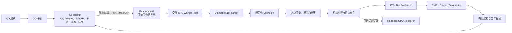

# QQBot Litematic 无头渲染服务：Go 网络服务 + Rust 渲染引擎

**文档状态：** Proposed  
**设计日期：** 2026-10-24  
**目标产品：** QQBot 投影图片渲染  
**实现语言：** Go（QQBot 接入与网络服务）、Rust（Litematic 解析与渲染引擎）  
**核心约束：** 渲染任务不启动 Minecraft Client 或 Server；画面使用独立模型与近似光照；默认 CPU 输出 PNG，GPU 仅作为以后可选的加速后端。

> 本文取代旧版以 Minecraft Dedicated Server、Server Mod 和 Render Client 为必需节点的架构。现在接受方块模型、光照和特殊对象的受控近似，因此无需维持 Minecraft 进程作为权威渲染器。

## 1. 摘要

Go 编写的 QQBot 服务负责接收平台事件、获取群文件、鉴权、任务生命周期、幂等、队列和结果投递；它把受控任务交给独立 Rust 渲染引擎。Rust 负责解析 NBT、生成适合静态图片的方块几何、执行近似着色和 CPU 光栅化，并返回 PNG 与渲染诊断。相同输入与相同渲染配置产生可缓存的确定性结果。

首版目标不是实现通用 Minecraft 客户端，也不追求完整游戏行为。它面向 QQBot 的固定相机图片任务，因此只需实现该产品需要的方块、材质、光照、透明度和输出尺寸。材料数量由投影解析数据计算；不依赖 Minecraft Server 统计。

现有 `Standalone-Litematic-Renderer` 作为功能和算法参考。它已经展示了独立 Java 场景构建、CPU 光栅化、PNG/GIF 导出、分块网格和 WebGL 交互预览。新服务将由 Go 网络/机器人层与 Rust 渲染核心组成；WebGL 预览不是服务器运行条件。

## 2. 产品目标与非目标

### 2.1 目标

- QQBot 用户发送投影后，机器人返回固定角度的 PNG 渲染图；默认配置可以输出一张或两张相反方位的轴测图。
- NBT 解压、结构解析、模型构建和图片生成均在受限的后台任务中执行，不阻塞 QQBot 事件循环。
- CPU-only 部署可工作，不要求显卡、窗口系统、Electron、Minecraft 安装或 Minecraft 登录状态。
- 以资源限额、取消、幂等提交、缓存和有限并发保护服务进程。
- 方块统计直接由解析后的 palette/positions 得出，并在诊断中区分空气、未知方块及不支持的特殊数据。
- 模型与着色行为明确版本化。扩展支持范围时不会悄悄改变已缓存结果。

### 2.2 非目标

- 与某一个 Minecraft 版本逐面、逐像素一致。
- 完整复刻原版天空光、方块光传播、AO、光照更新顺序或客户端颜色空间。
- 执行红石、方块 tick、生物 AI、物理、区块生成或游戏事件。
- 完整还原所有 Block Entity、物品组件、动态模型、粒子、动画和实体行为。
- 提供实时 3D 编辑器、自由漫游或游戏内交互。
- 通过 Minecraft Server 取得官方统计数据。

这些边界是产品取舍。对于不支持的对象，服务必须给出确定的 fallback 和诊断，不得因未知状态崩溃或无提示地丢失整份任务。

## 3. 高层架构



生产链中不运行 Minecraft Client 或 Server。Go `qqbotd` 是 QQBot 产品入口和对外网络边界；Rust `renderd` 是私有渲染执行器。后续 CLI 或其它 Bot 适配器可以复用 Go Job API 或直接实现私有渲染协议，但不能绕过输入预算与鉴权边界。

### 3.1 进程边界

| 组件 | 首版进程形态 | 主要责任 | 重要约束 |
|---|---|---|---|
| Go `qqbotd` | 常驻 Go 进程；QQ SDK 与 HTTP 服务可在同一进程 | QQ 事件、平台文件获取、权限、对外 Job API、幂等、用户/群限流、任务状态、队列、结果投递 | 网络 I/O 与 CPU 作业分离；不解析 NBT、不执行光栅化 |
| Rust `renderd` | 常驻 Rust 子进程/服务 | Litematic/NBT、Scene IR、模型、近似着色、CPU 光栅化、渲染缓存 | 私有本机接口；不接触 QQ 凭据、不直接发 QQ 消息 |
| CPU Worker Pool | `renderd` 内固定大小的受限线程池 | NBT、规范化、几何、光栅化、编码 | 不在 async executor 上跑大型同步循环；容量由 Go 队列准入与 Rust worker 上限协同约束 |
| 私有工作目录 | 两进程同机可访问的受限目录 | Go 暂存输入，Rust 写入 PNG/manifest，Go 读取并投递 | 每 Job 独立目录；仅传 UUID，不接受任意路径；原子发布与磁盘预算 |
| 可选 GPU Worker | 首版不启动 | 批量低延迟或特定部署的加速 | 独立 feature/profile，不改变默认 CPU 结果契约 |

### 3.2 语言边界

Go 用于 QQBot Adapter、对外网络 API、任务编排和平台交互；这让机器人协议与长连接处理留在适合网络服务的 Go 进程中。Rust 用于资源敏感且 CPU 密集的 NBT/Litematic 解析、规范 IR、几何构建、CPU 光栅器和渲染资产处理。两者不通过 FFI/cgo 共享复杂内存对象，而以版本化私有 HTTP 协议和受限共享工作目录通信；未来可替换为流式传输或远程 Worker，而不改变 QQBot Job API。

## 4. Go 对外 API 与 Go-Rust 私有协议

对外 Job API 由 Go `qqbotd` 实现；Rust `renderd` 不暴露公网/QQ 平台接口。两层接口分别版本化：外部接口服务 QQBot 与后续适配器，内部接口只表达一次渲染执行。API 先冻结字段语义，再实现 Worker。JSON 使用 UTF-8，文件上传使用 multipart 流式处理。

### 4.1 `POST /v1/jobs`

请求为 `multipart/form-data`：

- `file`：`.litematic` 原始文件。服务端流式落盘，不能先把完整文件读入一个无上限内存 buffer。
- `options`：JSON 渲染参数。缺省字段使用服务 profile 的显式默认值。
- `Idempotency-Key`：由 Adapter 根据 QQ 平台事件 ID 生成，重试同一事件时保持不变。

示例 `options`：

```json
{
  "profile": "qqbot-default-v1",
  "views": [45, 225],
  "elevation": 30,
  "width": 1024,
  "height": 1024,
  "background": "transparent",
  "lighting": "simple-ao-v1",
  "output": "png"
}
```

Go 成功接收并持久化 Job 后返回 `202 Accepted`：

```json
{
  "jobId": "job_01...",
  "status": "QUEUED",
  "statusUrl": "/v1/jobs/job_01...",
  "resultUrl": "/v1/jobs/job_01.../result"
}
```

相同幂等键、相同请求指纹再次提交时返回现有 Job。相同幂等键却带有不同文件或 options 时返回 `409 IDEMPOTENCY_CONFLICT`。创建记录必须原子化，不能采用“先查不存在、再插入”的竞态流程。

### 4.2 查询、取消和结果

| Endpoint | 行为 |
|---|---|
| `GET /v1/jobs/{jobId}` | 查询状态、阶段进度、错误码和预计输出信息 |
| `DELETE /v1/jobs/{jobId}` | 请求取消；终态 Job 返回幂等成功，不承诺回滚已完成的文件写入 |
| `GET /v1/jobs/{jobId}/result` | 完成时返回 PNG 或 `application/json` manifest；未完成返回 `409 JOB_NOT_READY` |
| `GET /v1/health` | 进程存活、版本与配置概要 |
| `GET /v1/ready` | API、Worker Pool、资源目录和可写缓存是否可以接单 |

图片结果包含 `Content-Type: image/png`，响应头提供 `X-Render-Manifest` 或另一个 JSON endpoint 返回摘要。图片、统计和诊断应能按 Job ID 关联。

### 4.3 统一错误结构

```json
{
  "error": {
    "code": "UNSUPPORTED_BLOCKS_PRESENT",
    "message": "渲染完成，但有部分方块使用了占位模型。",
    "retryable": false,
    "details": {
      "count": 12
    }
  }
}
```

| HTTP | 错误码示例 | 语义 |
|---|---|---|
| 400 | `INVALID_REQUEST` | multipart 或 JSON 格式错误 |
| 401/403 | `UNAUTHORIZED` / `FORBIDDEN` | API 身份或 Adapter 授权失败 |
| 409 | `IDEMPOTENCY_CONFLICT` / `JOB_NOT_READY` | 幂等冲突或结果尚未就绪 |
| 413 | `INPUT_TOO_LARGE` | 文件大小超过部署限制 |
| 422 | `INVALID_LITEMATIC` / `RESOURCE_LIMIT` | 文件结构错误或解析预算超限 |
| 429 | `QUEUE_FULL` | 无容量接收新 Job；可重试 |
| 500 | `INTERNAL_ERROR` | 未预期的内部故障；不泄漏路径或堆栈 |
| 503 | `RENDERER_NOT_READY` | 服务正在启动或资源未加载 |

Job 执行期失败记录在 Job 状态中；成功创建 Job 后，查询状态仍返回正常 HTTP 响应，错误细节放在 `failure` 字段中。

### 4.4 Job 生命周期

```text
RECEIVED → VALIDATING → QUEUED → PARSING → BUILDING_SCENE
         → RENDERING → ENCODING → SUCCEEDED

任何非终态 → CANCELLING → CANCELLED
任意阶段的不可恢复错误 → FAILED
```

状态变更单调前进。Go 持久化公开 Job 状态，并把 Rust 短期执行阶段映射到公开状态；Rust 重启不能抹去 Go 已接受的 Job。进度表示阶段与阶段内计数，不通过估算制造看似精确的百分比。`FAILED` 记录稳定错误码，内部 stack trace 只进受控日志。

### 4.5 Go 到 Rust 的私有渲染协议

Go 是面向用户的 Job 生命周期权威来源：它持久化任务状态、处理 QQ 平台重投递、执行群/用户限流、决定重试并最终交付图片。Rust 维护短期执行状态和渲染缓存，不拥有 QQ 事件幂等语义，也不直接重试平台操作。

首版两个进程同机运行。Go 将输入流写入私有工作根目录下由 UUID 命名的 Job 目录；Rust 只接收 `workspaceId` 和正整数 `attempt`，自行从配置根目录解析固定的 `input.litematic` 与 `attempt-{n}/output.png`、`attempt-{n}/manifest.json`，不接受客户端传入任意文件系统路径。各 attempt 输出隔离，Rust 写入临时文件，校验完成后原子发布 PNG 与 manifest。该边界避免把大型输入/输出复制到 JSON，也避免跨语言共享内存布局，并避免重试与仍在退出的旧 attempt 争写同一产物。

| 私有 endpoint | 请求/响应语义 |
|---|---|
| `POST /internal/v1/renders` | Go 提交 `requestId`、`workspaceId`、`attempt`、渲染 options；Rust 返回 `202` 和执行状态。重复的同一 `requestId` + 相同请求指纹返回原执行；同 ID 不同内容返回 `409` |
| `GET /internal/v1/renders/{requestId}` | Rust 返回短期执行状态、阶段、诊断和终态 manifest 摘要；Go 将其映射到公开 Job 状态 |
| `DELETE /internal/v1/renders/{requestId}` | 请求取消 Rust 执行；Go 取消用户 Job 时调用此接口，并清理尚未发布的临时产物 |
| `GET /internal/v1/ready` | Rust 报告 renderer/catalog/assets 版本、CPU worker 容量、工作目录与资源是否就绪 |

内部请求示例：

```json
{
  "requestId": "job_01..._attempt_1",
  "workspaceId": "01...",
  "attempt": 1,
  "profile": "qqbot-default-v1",
  "views": [45, 225],
  "elevation": 30,
  "width": 1024,
  "height": 1024,
  "background": "transparent",
  "lighting": "simple-ao-v1"
}
```

`workspaceId` 和 `requestId` 由 Go 生成并校验格式。Rust 服务只监听 loopback，并用本机随机 token 认证；工作根目录需配置为 Go/Rust 共同可访问的固定目录。Rust 的短期执行状态可以在进程重启后丢失，Go 根据自身持久状态将过期的 `RUNNING` attempt 标记为可重试或失败；重新执行使用新的 attempt ID，保留同一个 workspace。Go 的队列负责持久准入与公平性，Rust 的有界 worker queue 只负责保护引擎容量，队列满时立即返回可重试的 `429 RENDER_CAPACITY_FULL`，不形成无界双重排队。

开发/部署初期两进程必须同机共享工作根目录。远程 Rust Worker 不属于首版；届时应改用明确的流式/对象存储协议，而不能假设本机路径可跨主机访问。

## 5. Litematic 导入与规范 Scene IR

### 5.1 Parser 职责

Parser 接收受限的字节流，检测支持的压缩形式，解码 NBT，读取元数据、多个 region、palette、block states 和受支持的 block entity 数据。它不生成纹理、不访问 GPU、不调用 QQ API。

输出 `Scene IR` 是 Rust 模块之间的稳定边界：

- 区域原点、尺寸、坐标变换与 bounds 均使用明确的有符号整数。
- 方块表示为规范化的 `namespace:block` 加属性集合；未知 namespace/state 保留原字符串并标记未知，不映射到错误的数值 ID。
- Palette 索引和 packed long 数据解包后转为可分块读取的紧凑存储；避免将全结构重复展开成每方块 heap object。
- 多区域和负坐标被保留。区域重叠按配置中的确定顺序处理并输出诊断，不静默丢区。
- 容器/告示牌等可支持的静态 block entity 数据复制到类型化数据；不认识的 NBT tag 保留摘要或忽略并计数，不交给模型代码任意递归处理。
- 材料统计直接对规范 BlockState 计数，分别报告空气、普通方块、未知 ID 和特殊数据。

### 5.2 解析限制

所有上限通过配置设定并在接收边界校验：输入字节、解压字节、NBT 深度、List 长度、Region 数、体积、非空气方块数、palette 项数、Block Entity 数据字节、坐标绝对值和输出像素数。对 gzip bomb、整数溢出、负长度和越界 bit index 必须失败关闭。

解压数据不必一次性保留完整副本。Parser 优先用分块读取与惰性 section/page 存储；确实需要物化时，所有 buffer 计入 Job 的内存预算。

### 5.3 Scene IR 示例

```rust
struct Scene {
    bounds: BoundsI64,
    regions: Vec<Region>,
    block_entities: Vec<SupportedBlockEntity>,
    statistics: BlockStatistics,
    diagnostics: Vec<Diagnostic>,
}

struct BlockStateKey {
    name: ResourceLocation,
    properties: SmallSortedMap<String, String>,
}

struct Region {
    origin: [i64; 3],
    size: [u32; 3],
    palette: Vec<BlockStateKey>,
    states: PagedPackedIndices,
}
```

示例只表达边界意图，不锁定具体容器 crate；公开 DTO 不暴露 parser 内部 buffer 布局。

## 6. 方块、模型与材质支持策略

### 6.1 数据驱动 Block Catalog

Block Catalog 按 `BlockStateKey` 解析成 `BlockModel`、材质引用、渲染层、遮挡规则、tint 和 fallback。渲染 profile 和资源集有独立版本及内容 hash。模型系统不得假设所有方块都是一个完整立方体。

首批模型建议按投入分层：

| 类别 | 首版策略 | 未支持时的处理 |
|---|---|---|
| 普通完整方块 | 方块状态名/材质映射、可见面生成、可选 greedy merge | 统一缺失方块纹理并计数 |
| 常见 partial block（台阶、楼梯、栅栏、门等） | 曲面/箱体由手工数据模型覆盖常见状态 | 占位几何加状态名诊断 |
| 透明方块（玻璃、水、树叶） | 区分 opaque/cutout/blend；控制双面与排序 | 半透明占位或退化 cutout，并记录 |
| 简单 Block Entity（箱子、告示牌等） | 固态静态模型或简单文字面 | 方块本体加简化图标/摘要 |
| 动态实体、复杂组件与动画 | 不渲染或使用静态图标 | diagnostic 中列出类型和数量 |

优先按 QQBot 实际投影样本决定覆盖顺序，不以“Minecraft 全方块兼容”为项目门槛。

### 6.2 资源来源与可复现性

材质资源可以从经过授权的资源包或部署者提供的资源目录导入。每个资源项记录来源、许可说明、内容 SHA-256 和优先级；缺少材质时使用项目自带的原创 fallback palette。部署包不得默认捆绑完整 Minecraft 客户端或未审核来源的资源。

仓库 `Standalone-Litematic-Renderer` 的架构与算法可作为研究参考。直接复制它的源码、材质或字体之前，需要单独确认仓库及各资产的许可；本设计不假设它们可以再分发。

## 7. 近似光照与画面模型

### 7.1 首版光照模式 `simple-ao-v1`

每个可见面根据法向使用固定方向光系数，叠加统一环境亮度；角点 AO 由相邻占据/遮挡格采样得到。发光方块先用局部固定 emissive strength 表现，不进行原版全场光传播。材质 tint 可按有限的 biome/tint palette 计算；没有 biome 信息时使用 profile 默认颜色。

这使建筑体块可读且输出稳定，成本远低于全体素光照传播。若无阴影需求，可提供 `flat-v1` 模式令所有朝向使用同一亮度；两种模式都不承诺 Minecraft 原版数值一致。

### 7.2 可选增强模式

只有用户样本显示简单模式不足时，才实现有限半径的局部光传播，或按天空开口与简单发光源做场景内 flood fill。它必须作为新 `lightingProfileVersion` 出现，缓存键随之变化，不可悄悄改变 `simple-ao-v1`。

### 7.3 Alpha 与材质分层

渲染顺序固定为背景、opaque、cutout、透明排序/近似透明层、可选轮廓/阴影。Alpha cutout 对叶片与细纹理优先保留硬边；玻璃、水等半透明材质采用可控排序和合成。透明层无法准确排序的场景应记录 profile 限制。

## 8. CPU 几何构建与光栅化

### 8.1 场景网格

每个 region 分成固定体素边长的处理页。遍历非空气 state，解析模型状态并生成可见面；被完全遮挡的共面块内部面不生成。对材质、UV、Tint、光照一致的规则完整方块，可将相邻 coplanar faces 合并。非立方体和特殊模型使用通用 quad 路径。

Greedy meshing 不能跨越透明类别、纹理 tile、Tint 或 shading 不同的面。每个 mesh page 保留 world bounds、material bucket、face count 和源页标识，支持流式写盘、取消和缓存。

### 8.2 CPU Tile Rasterizer

输出固定 camera preset 的 PNG，采用并行 tile raster：

1. 由 AABB 变换出投影屏幕 bounds 和 depth bounds。
2. 按渲染层排序，生成每个 tile 的可见 primitive list。
3. tile 由单一 worker 独占颜色、深度 buffer 区域，避免每像素锁。
4. 用三角形 edge function 覆盖测试、depth test、纹理采样和 alpha 处理。
5. 图像块完成后合并/编码 PNG；图片尺寸和临时 buffer 纳入内存预算。

正交轴测投影优先用于建筑预览。需要更自然的内部视角时可增加透视 preset，但属于后续 API 的 additive option。

### 8.3 CPU/GPU 选择

首版 QQBot 是离线图片任务，无需保持画布帧循环，因此 CPU 光栅化作为必选路径，GPU 不启动。高并发性能不足时先测量解析、模型生成、光栅化和编码各阶段，再选择提升 greedy mesh、纹理缓存、tile 尺寸或 worker 预算。

如实测证明 CPU 是主要瓶颈，才增加 headless GPU backend（例如独立 `wgpu`/Vulkan feature）。GPU 后端需支持无窗口输出、设备丢失 fallback、独立 VRAM 预算以及 CPU golden tests。它不能成为部署硬依赖，也不能通过无限增加并发任务争抢单张显卡。

## 9. 并发、队列和取消

### 9.1 执行模型

- Go 网络层处理 QQ 事件、HTTP、文件流、状态查询和持久排队；它以有界调度器向 Rust 派发执行请求。
- Rust `renderd` 的 HTTP runtime 只承载私有协议；NBT Parser、模型构建和光栅化进入固定大小的全局 CPU pool，不允许每个 Job 各自创建全核线程池。
- 一个 Job 内可以按 section/page 和 raster tile 并行；多个 Job 的并行度受 CPU 预算和内存估算共同限制。
- Queue admission 按 bytes、非空气方块、估算面数、输出像素和预估内存的加权 cost，而非只按任务数量。
- Go 的持久队列公平策略优先 FIFO；超大 Job 可按用户配置与大小采用分层队列，同一 QQ 用户/群的速率独立限额。Rust 只保留有界执行队列，满载即拒绝，不积压第二条无界队列。

### 9.2 取消

取消 token 在 NBT tag/page、section 构建批次、tile 批次和 PNG page flush 之间轮询。临时资源带 Job ID 所有权；取消后等待当前 CPU task 安全退出，再回收内存与临时文件。幂等缓存只在完整 Job 发布后写入，不能将半成品标为命中。

### 9.3 建议的服务上限

具体数字由 Phase 0 测量配置，下面这些维度必须独立限制：

| 预算 | 控制对象 |
|---|---|
| 输入 | 上传字节数、解压 NBT 字节数、tag 深度、region/palette 数 |
| 场景 | 总体素数、非空气数、预估 mesh faces、Block Entity 字节 |
| 图片 | 宽、高、像素总量、同时存活的 framebuffer 数 |
| 任务 | 队列总 cost、每群/用户并发、每个 Worker 活动任务数 |
| 存储 | 上传临时目录、场景缓存、PNG 结果缓存、诊断日志 |
| 时间 | 解析、构建、渲染阶段 deadline 和总 Job TTL |

## 10. 缓存与输出

### 10.1 缓存键

`renderKey = SHA256(inputBytesHash || rendererBuildHash || catalogHash || assetManifestHash || lightingProfile || cameraPreset || outputOptions)`。

相同内容可复用 PNG 与统计结果。文件名、时间戳和文件大小不能单独作为正确性依据。用户上传原文件不得因输出缓存清理而意外删除。

### 10.2 原子发布

结果先写入 Job 临时目录，校验 PNG 完整性和 manifest 后以原子 rename 发布。manifest 至少记录：input hash、renderer/catalog/assets 版本、视角、分辨率、绘制的 block/face 计数、未知/占位 block 计数、阶段耗时、缓存命中情况、结果 hash。

PNG cache 按实际磁盘字节 LRU 清理；正在被 Job/QQBot 上传引用的文件加 lease，不得被淘汰。

### 10.3 结果交付

Adapter 获取结果文件后上传到 QQBot，并在群消息中说明未知方块或降级数量。渲染服务不保存 QQ 凭据、不直接发消息。结果上传失败由 Adapter 根据平台错误重试；重复提交由幂等键合并。

## 11. 安全与稳定性

- 上传文件按不可信输入处理；阻止 gzip bomb、恶意 NBT 深度、数组乘法溢出和超范围坐标。
- 文件名只用于显示，存储路径由 Job UUID 生成；杜绝路径穿越和符号链接逃逸。
- 图片和缓存目录限定在配置 root 下；缓存清理只按 manifest 管理的文件删除。
- Rust 私有 API 只 bind loopback，并校验 Go/Rust 启动时生成的本机 token。Go 面向适配器的 API 默认 bind loopback；若 QQ Adapter、Go API 或 Rust Worker 跨主机，必须启用认证、TLS、请求限速和可轮换 secret。
- 日志不写 QQ access token、完整文件路径、原始上传内容或不必要的用户群标识。
- Go panic 与 Rust panic 都必须在进程/任务边界被记录；Rust 任务 panic 标记 `WORKER_PANIC`，无法保证引擎状态安全时隔离并重启 Rust Worker/子进程。
- Go 持久 Job 状态不依赖 Rust 内存状态。Rust 重启后，Go 识别没有终态的过期 attempt，并按策略重新派发或失败；同一 Rust Worker crash 不应丢失其它 Go Job 状态。

## 12. 测试与验收

### 12.1 数据正确性

- NBT 压缩、损坏 tag、未知 tag、嵌套上限、负坐标、多 region、region 重叠。
- palette 位宽边界、packed long 跨 word、空 palette/空气、最大索引和截断数据。
- 相同输入的 block stats 稳定，region 变换后坐标与 bounds 正确。
- 未知方块、安全 fallback、透明方块和不支持 block entity 的诊断完整。

### 12.2 图像回归

- 固定 corpus 覆盖 cube、stairs/slab、fence、leaves/glass/water、负坐标、多区域、细长结构和超大稀疏投影。
- 固定 camera/lighting/assets 生成 PNG golden；CPU 不同 worker 数输出应在定义的误差范围内一致，最好保持 byte deterministic。
- 与 Standalone-Litematic-Renderer CPU 输出可作视觉参考，不作为强制逐像素正确标准；差异报告按区域、颜色和 block 类别归因。
- 对透明排序、背面剔除、贴图采样边界、角点 AO 和超大坐标单独设回归。

### 12.3 服务行为

- 同一幂等键重复提交只生成一个 render result；不同 body 冲突失败。
- Queue full/用户限流/取消/超时/worker panic/磁盘不足/结果重试的状态迁移确定。
- 正确的缓存失效：input、renderer build、catalog、assets、lighting、camera、resolution 任一变化都失效。
- 并发压力用 CPU、RSS、临时磁盘和缓存预算验证，确认不会因多个大任务同时导入而 OOM。

### 12.4 性能基准

用真实 QQ 群常见投影和大型样本，分别记录 parse、scene build、mesh、raster、PNG、排队时间及 peak RSS。至少覆盖小型常见图、中型复杂图、大型密集图和大型稀疏图。首版验收阈值在取得代表性 corpus 后确定，不从 Java 或浏览器 GPU 数字推算 Rust 性能。

## 13. 交付阶段

### Phase 0：输入与画质基线

- 收集经过授权的真实 `.litematic` 夹具和现有目标图片。
- 确定 QQBot 默认视角、图片尺寸、透明背景/底色、常见群文件体积和允许等待时间。
- 建立支持方块清单、资源来源清单与每张图的人工视觉验收基线。

### Phase 1：Rust parser 与统计

- 实现 streaming upload、NBT decode、region/palette/packed-state 解码和资源预算。
- 输出 Scene IR 与 block stats JSON，不先引入模型或 renderer。
- 建立坏文件拒绝、负坐标、多 region 和大型输入的测试 corpus。

### Phase 2：Common block geometry

- 加载版本化 Block Catalog 和材质 atlas。
- 支持完整 cube、面剔除、常见 partial shape、透明分类与未知 fallback。
- 建立 section mesh 与可复现的模型 manifest。

### Phase 3：CPU PNG renderer

- 实现正交轴测相机、tile rasterizer、depth buffer、纹理采样、cutout、简化透明和 `flat-v1`/`simple-ao-v1`。
- 输出 QQBot 默认角度图片与诊断 manifest。
- 用大、中、小样本测 peak memory、耗时和输出稳定性。

### Phase 4：Go QQBot 服务生产化

- 实现 Go `qqbotd` 的 QQBot Adapter、对外 Job API、event-id 幂等、群权限、用户限速、文件取回与图片发送。
- 实现 Go 持久有界队列及 Go-Rust 私有协议适配；加入状态查询、取消、错误转译、结果交付与工作目录清理。
- 端到端压测上传、多个并发 Job、QQ 上传失败重试和服务重启恢复。

### Phase 5：按用户价值扩展

- 根据真实投影出现频率扩展 Block Catalog / Block Entity 简化模型。
- 依据 benchmark 决定 GPU backend、更多灯光传播、GIF 或额外角度是否值得做。
- 每个新视觉模式建立新的 profile 版本并更新 golden corpus。

## 14. 风险与应对

| 风险 | 影响 | 应对 |
|---|---|---|
| 近似模型被用户认为“不像 Minecraft” | 图片可信度下降 | 先支持 QQ 群最常见的方块，未知块有统一 fallback 和可见诊断 |
| CPU 渲染吞吐不足 | 队列增长 | greedy meshing、稀疏页、tile 并行、输出限额；先基准再选可选 GPU |
| 大型投影峰值内存过高 | Worker OOM | packed state/page streaming、按成本准入、阶段预算、隔离 Worker |
| 透明排序和玻璃/水表现欠佳 | 局部图像瑕疵 | 独立 transparent pass、常见材质分类、记录降级场景 |
| 资源包来源/许可不清楚 | 无法安全打包 | provenance/许可清单、部署者导入、原创 fallback；审核通过前不捆绑 |
| 新模型变更导致旧图缓存被复用 | 错图 | render/catalog/assets/lighting hash 纳入缓存键 |
| QQ 平台重投递造成重复渲染/刷屏 | 资源浪费 | 以事件 ID 建幂等键，Job 结果复用、群/用户速率限制 |

## 15. 架构决策记录

### ADR-001：Go 负责 QQBot 网络服务，Rust 负责渲染；Minecraft 进程不在生产依赖中

**状态：** Accepted  
**决策：** Go `qqbotd` 负责 QQBot 接入、对外网络 API、鉴权、幂等、任务状态、持久队列与消息投递；Rust `renderd` 负责 NBT/Litematic、Scene IR、几何构建、CPU renderer 和渲染缓存。两者通过版本化私有 HTTP 协议及受限工作目录协作。生产任务不启动 Minecraft Client/Server。

**理由：** Go 将 QQBot 长连接、协议适配与网络任务编排放在专用服务层；Rust 将高负载解析和光栅化与机器人生命周期隔离。已接受明确的离线近似质量目标，独立 CPU 流水线消除 GUI、显卡、Minecraft 登录和启动时长依赖。

**代价：** 需要维护 Go-Rust 协议、同机工作目录与双进程部署；自行维护 Block Catalog、模型和近似着色，支持范围通过 diagnostics 明示。

**考虑过的替代方案：**

- 全部用 Rust：进程与类型系统更统一，但不符合已选定的 Go 网络/QQBot 服务边界。
- Go 通过 cgo 直接嵌入 Rust：少一个本机 HTTP 边界，但会引入跨语言 ABI、生命周期、panic/崩溃隔离及构建发布耦合；首版不采用。
- Minecraft Client/Server 负责渲染：画质上限更高，但已超出当前近似渲染目标，并增加启动、资源与运行负担。

### ADR-002：首版用 CPU tile rasterizer，GPU 是可选后端

**状态：** Proposed  
**决策：** 默认生成图片不创建 GPU context。CPU 按 section 和 tile 并行；只有基准证明 CPU 不满足队列 SLO 后，增加独立 headless GPU backend。

**理由：** Bot 输出是批量 PNG，不需要常驻交互帧循环；CPU-only 部署可预测，也让显卡可留给其它工作。

**代价：** 超大图/高并发可能更慢；通过预算、缓存、分块和限流保护吞吐。

### ADR-003：用版本化近似渲染 profile 管理质量取舍

**状态：** Proposed  
**决策：** 默认 `simple-ao-v1`，同时提供统一亮度的 `flat-v1`。Block Catalog、资产 manifest 和 lighting profile 都版本化并进入 render cache key。

**理由：** 避免把视觉近似误称为原版光照；同样输入下保持确定性，允许以后渐进改善。

**代价：** 改善模型/光照需要更新 golden images 和 cache version。

### ADR-004：Go QQBot 服务是首要入口，Job API 与 Rust 渲染协议分层

**状态：** Accepted  
**决策：** Go `qqbotd` 承载首个 QQBot Adapter 与对外 HTTP Job API；Rust renderer 只提供 loopback 私有 Render API，不依赖 Bot SDK。其它入口可复用 Go Job API，未来的其它服务也可在满足安全预算后适配 Rust 协议。

**理由：** 保持 QQBot 产品体验优先，同时把平台重试、权限、文件获取与渲染任务隔开。

**代价：** 需要维护 Job 状态到 QQ 消息的映射、Go-Rust 执行状态映射，并处理平台文件 URL 过期和发送失败。

### ADR-005：方块统计来自投影解析，不查询 Minecraft Server

**状态：** Proposed  
**决策：** 材料数量以 Litematic palette/索引为数据源，Unknown/air/supported categories 分开计数；不请求 Minecraft Server。

**理由：** 产品任务不需要模拟真实世界运行统计；投影本身已携带静态方块数据。

**代价：** 动态战利品、运行时 Block Entity 状态和实体行为不会被推导成游戏内真实结果。

## 16. 实现前需确认

1. Go QQBot 服务采用哪种 QQ 接入协议/SDK；QQ Adapter 与 Go Job API 是否同进程运行（建议首版同进程）。
2. 默认返回一张图还是两个相反方位的图，是否保留群里合成总览图的处理。
3. 真实投影样本中最常见的方块、实体和 Block Entity 排名。
4. 首版允许的最大输入字节、方块数、图片尺寸、等待时间和每个群的并发数。
5. 运行目标主要是 Windows 还是 Linux，是否要求同一二进制跨平台。
6. 材质资产由服务部署者提供、从授权资源包导入，还是首版使用原创调色板。
7. 同一内容图片是否可跨用户缓存，输入文件和图片保留多久。

## 17. 参考仓库与源码入口

- [Standalone-Litematic-Renderer README](https://github.com/wocenimenma0220/Standalone-Litematic-Renderer)
- [Java CPU pipeline：SchematicRenderer.java](https://github.com/wocenimenma0220/Standalone-Litematic-Renderer/blob/main/src/io/github/litematicrender/render/SchematicRenderer.java)
- [Java CPU rasterizer：Rasterizer.java](https://github.com/wocenimenma0220/Standalone-Litematic-Renderer/blob/main/src/io/github/litematicrender/render/raster/Rasterizer.java)
- [现有 CPU/GPU 视图实现：gpu-view.js](https://github.com/wocenimenma0220/Standalone-Litematic-Renderer/blob/main/webapp/renderer/gpu-view.js)
- [Electron 调用与 preview backend：renderer.js](https://github.com/wocenimenma0220/Standalone-Litematic-Renderer/blob/main/webapp/renderer/renderer.js)
- [Java JSON-RPC 服务：JsonRpcServer.java](https://github.com/wocenimenma0220/Standalone-Litematic-Renderer/blob/main/src/io/github/litematicrender/serve/JsonRpcServer.java)
- [开发和 CLI 导出说明：DEVELOPMENT.md](https://github.com/wocenimenma0220/Standalone-Litematic-Renderer/blob/main/docs/DEVELOPMENT.md)
- [光照实现目录](https://github.com/wocenimenma0220/Standalone-Litematic-Renderer/tree/main/src/io/github/litematicrender/render/scene)

---

本设计把服务目标收敛到“QQBot 可持续运行的静态投影渲染任务”：Go 承担网络与任务服务，Rust 承担独立 CPU 渲染。渲染 fidelity 由支持范围、profile 版本和测试图片定义；CPU 是可运行基线，实际并发与时延由项目 corpus 的基准结果决定。
